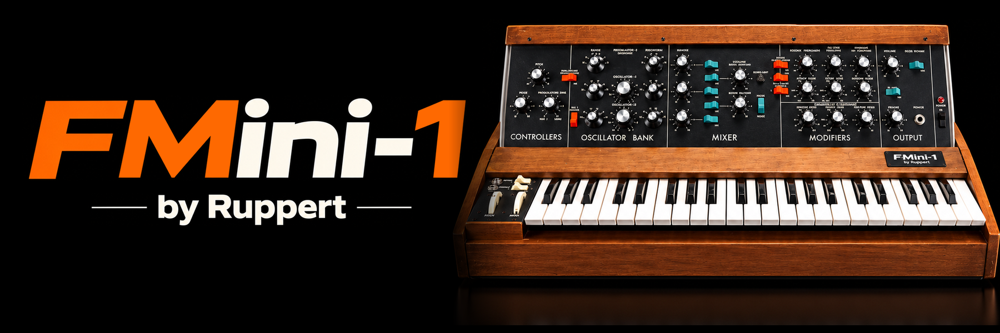

<p align="center">
  
</p>

# FMini-1 + AP Panel

A fork of [FMini-1](https://github.com/ruppert/fmini-1) (the Minimoog Model D emulation for the M-Vave FM-1) that **adds an aircraft autopilot panel mode on top of the synthesiser**. The synth is not replaced: the instrument still powers up as FMini-1 and keeps all of its sounds, effects, arpeggiator, sequencer, scale assistant and editor. The AP panel is an extra mode you enter and leave with a long press of HOME.

Current firmware: **v2.5.29** (`FM-1_900`, board `fm1`).

## 1. What the AP panel does

Hold **HOME** for about one second to enter the AP panel; hold HOME again to leave. Entering takes over the screen, the keys and the LEDs. Leaving restores the FMini-1 synth page exactly as it was — **all sound-generation features remain intact**. Inside the AP panel the keys are used as silent AP switches and the synth's note playback is muted (`fm1_notes_mute`); outside it, the instrument plays normally.

The panel shows four AP targets — **HDG / ALT / SPD / VS** — with DSEG7 digits, plus twelve switch labels (AP, FD, A/T, NAV, VNAV, HDG, ALT, VS, SPD, LOC, APR, FLC). When a bridge is connected it also shows the live flight values, alternating with the targets every 5 s (white = selected target, green = live actual).

On entry the four transport LEDs play an aircraft-exterior-light welcome sequence, looping while the mode is active: PLAY green (beacon) and REC red (anti-collision) flash twice with a 3 s gap on an 8.8 s cycle; EDIT and GLO white (strobe) double-flash every 5 s independently.

## 2. Controls in AP mode

| Control | Function |
| --- | --- |
| **K1–K4** | HDG / ALT / SPD / VS — relative MIDI CC 20–23 (`64 + delta`) |
| **SELECT / PRESET / ALGO encoders** | relative MIDI CC 24–26 |
| **OCT− held + K1–K4** | ×10 on the AP knobs (the firmware applies the multiplier) |
| **12 white keys** (F3–G5) | AP switches — note on/off 48–74 on channel 1 (keys 0,2,4,6,7,9,18,19,21,23,24,26), mapped by the bridge to simulator events |
| **HOME (long press)** | enter / leave the AP panel |
| **HOME (short press)** | back / exit as usual |

Targets are drawn in bright white, active switches in green. Touching a control pops its value up for 3.5 s; the normal view holds the selected target for 8 s after a turn so it does not appear to bounce back.

## 3. PC bridge (MSFS / SimConnect)

The firmware does not talk to the simulator by itself. A Python bridge on the PC does:

- reads the AP targets and live flight data from the sim over **SimConnect**;
- streams one compact **SysEx** state frame to the FM-1 about every 100 ms;
- receives the panel's MIDI CC / NOTE messages and applies them to the sim.

The bridge lives outside this repository (`fm1_bridge.py` on the flight-sim machine). Firmware-side protocol:

| Direction | Message | Meaning |
| --- | --- | --- |
| PC → FM-1 | `F0 7D 41 01 <27 bytes> F7` | frame v1: hdg, alt, spd, vs, ias, alt_act, hdg_act, vs_act, flags — each value 3×7-bit bytes, then 2 flag bytes |
| PC → FM-1 | `F0 7D 41 00 <14 bytes> F7` | frame v0: targets + flags only |
| FM-1 → PC | CC 20–26, value `64 + delta` | relative knob moves (delta is already the detent count) |
| FM-1 → PC | NOTE 48–74 on/off, ch 1 | AP switch presses / releases (12 keys, see table above) |

With no bridge frames for 500 ms the panel edits its own target values locally, so it is usable offline too; a press still toggles the local switch flag and lights the LED.

## 4. Build and install

This is an FMini-1 / Felucca tree. Building needs JieLi's Linux toolchain and the AC79 SDK (see [BUILDING.md](BUILDING.md)); the toolchain installer is `tools/get_toolchain.sh` and the SDK is `fw-AC79_AIoT_SDK` (branch `AC79NN_SDK_V1.2.1_2023-12-13`). On macOS/Linux:

```
./build.sh                          # build/fmini-1-fm1-<version>.fwsc
python3 tools/fm1_install.py build/fmini-1-fm1-<version>.fwsc --yes
```

On Windows use `py tools\build.py` with `JIELI_TOOLCHAIN`, `AC79_SDK` and `JIELI_DOCKER=0` set. Installing firmware is at your own risk; recovery needs [FM-1-transporter](https://github.com/kurogedelic/FM-1-transporter) if an install is interrupted.

## 5. Credits

The base instrument, **FMini-1**, was made by Guilherme Ruppert and is inspired by / partially based on [Felucca](https://github.com/hugelton/Felucca) by Leo Kuroshita (Hügelton Instruments). The AP panel mode is a port of the autopilot panel from the [fm1_open](https://github.com/) firmware. This fork keeps the original synthesiser intact and adds the AP mode, the bridge protocol and the LED welcome sequence.

Licensed under [GPL-3.0-only](LICENSE).
